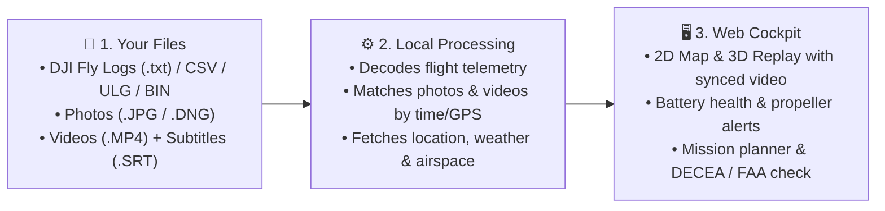

# Drone Manager (DJI Mini 3 · Telemetry & GIS)

Local-first Geographic Information System (GIS) and web telemetry cockpit to manage flights, photos, videos, object detection, and maintenance for **DJI Mini 3** drones (as well as other DJI models like Phantom 4, Litchi/Airdata CSV, PX4 `.ulg`, and ArduPilot `.bin` via EXIF/XMP/GPS metadata and `.SRT` subtitles).


---

## 1. Overview

**Drone Manager** locally processes encrypted flight logs from the DJI Fly app (`DJIFlightRecord_*.txt`, plus Litchi/Airdata `.csv`, PX4 `.ulg`, and ArduPilot `.bin`), photos (`.jpg`, `.jpeg`, `.dng`), videos (`.mp4`, `.mov`), and subtitle tracks (`.SRT`), consolidating everything into a local SQLite database (`data/drone.db`). The **DJI Cockpit** web interface (with **Light / Dark Theme** toggle) provides 2D maps (Leaflet), 3D flight replay over real terrain (CesiumJS), live flight instruments, photogrammetry (Footprint/GSD), a 360° spherical viewer (Pannellum), aerial object detection (YOLO11s VisDrone via ONNX), local semantic photo search (CLIP ViT-B/32 ONNX), and automated airspace & compliance checks for both **Brazil (ANAC / DECEA)** and the **United States (FAA Part 107 / UDDS / ADDS)**.


---

## 2. How It Works

**Drone Manager** runs 100% on your machine (never uploading your photos or videos to the cloud) and turns raw drone files into an interactive dashboard in **3 simple steps**:



1. **Automatic file ingestion:** Point the app to your SD card or external drive media folder and upload your flight logs (`DJIFlightRecord_*.txt`, `.csv`, `.ulg`, `.bin`).
2. **Smart correlation:** The backend reads GPS and timestamps from every photo/video, automatically links media to the matching flight, resolves the neighborhood/city via reverse geocoding, and fetches historical hourly weather (wind, temperature, precipitation) at takeoff time.
3. **Cockpit visualization:** In your browser, watch synchronized 2D/3D flight replays alongside the drone video, monitor battery cell health and propeller wear, and check **DECEA (Brazil)** or **FAA (USA)** airspace before flying.

---

## 3. Easy Installation (Quick Start Guide)

Never used a terminal or Python before? Follow these steps one command at a time.

### Step 1 — Open the Terminal (Linux or Windows 11 with WSL2)
- **On Linux (Ubuntu/Debian):** Open the **Terminal** app.
- **On Windows 11:** Open **Ubuntu (WSL2)** from the Start Menu.
  > *If WSL2 is not installed yet on Windows 11, open PowerShell as Administrator, run `wsl --install`, and reboot.*

### Step 2 — Clone the repository and install system tools
In the terminal, navigate to where you want to store the project and install the required system utilities (`python3-venv`, `exiftool`, `ffmpeg`, and `cargo`):

```bash
git clone https://github.com/acciolycruz/drone-manager.git ~/drone-manager
cd ~/drone-manager
sudo apt update && sudo apt install -y python3 python3-venv python3-pip libimage-exiftool-perl ffmpeg cargo
```

Next, install the official DJI log decoder (`dji-log`):

```bash
cargo install --git https://github.com/lvauvillier/dji-log-parser dji-log-cli
```
*(The `dji-log` binary will be saved automatically to `~/.cargo/bin/dji-log`.)*

### Step 3 — Create the Python virtual environment and install dependencies
Inside `~/drone-manager`, create an isolated virtual environment (`.venv`) and install the packages listed in [`requirements.txt`](requirements.txt):

```bash
python3 -m venv .venv
source .venv/bin/activate
pip install -r requirements.txt
```

### Step 4 — Configure `.env` (required vs. optional keys)
Copy [`.env.example`](.env.example) to `.env` and restrict file permissions:

```bash
cp .env.example .env
chmod 600 .env
```

Edit `.env` with `nano .env` (`Ctrl+O` + `Enter` to save, `Ctrl+X` to exit):

- **Works out of the box with no keys:** You can immediately organize photos and videos, read GPS/EXIF and `.SRT` tracks, view 2D maps, plan missions, check DECEA/FAA airspace, and run local object detection.
- **`DJI_API_KEY` *(Optional — free)*:** Only required to decrypt v13+ `.txt` flight logs from the DJI Fly app. Obtain a free key from the DJI Developer Open API portal.
- **`CESIUM_TOKEN` *(Optional — free)*:** Only required for global 3D terrain in **3D Replay** mode (CesiumJS). The 2D map works without it.

### Step 5 — Start the server
Run the startup script:

```bash
./start.sh
```

Once the server is running, open your browser and go to:
**http://127.0.0.1:8000**

### Step 6 *(Optional — Windows 11 + WSL2 only)* — Create a Desktop shortcut
To avoid opening a terminal manually each time, create a **Drone Manager** Desktop shortcut by running this command inside WSL2:

```bash
powershell.exe -NoProfile -ExecutionPolicy Bypass -File "$(wslpath -w ~/drone-manager/windows/criar-atalho.ps1)"
```

This uses [`windows/criar-atalho.ps1`](windows/criar-atalho.ps1) to copy [`windows/DroneManager.ps1`](windows/DroneManager.ps1) and `windows/drone.ico` into `%LOCALAPPDATA%\DroneManager`. Double-clicking the **Drone Manager** icon checks if port `8000` is active, starts `./start.sh` in WSL2 if needed, and opens `http://localhost:8000`.

---

## 4. Folder Structure

```text
drone-manager/
├── app.py                  # FastAPI backend, SQLite migrations, parsers, and REST routes
├── static/
│   ├── i18n/               # UI & report translations (pt-BR.json, en.json, es.json)
│   └── index.html          # Single-file SPA frontend (DJI Cockpit, Leaflet, Chart.js, CesiumJS, Pannellum)
├── data/
│   ├── drone.db            # Local SQLite database
│   ├── logs/               # DJIFlightRecord_*.txt / .csv / .ulg / .bin flight logs
│   ├── logs_ignorados/     # Discarded/corrupted logs with no takeoff
│   ├── media/              # Default local folder for photos/videos/.SRT
│   ├── models/             # Cached ONNX models (yolo11s_visdrone.onnx, CLIP)
│   ├── orthos/             # Imported GeoTIFFs, PNG previews, and NodeODM workdir
│   └── thumbs/             # Cached JPEG thumbnails (400px) and temporary HUD clips
├── .env.example            # Documented environment variable template (no secrets)
├── .gitignore              # Keeps .env, database, flight logs, media, and cache out of git
├── requirements.txt        # Python dependencies with minimum compatible versions
├── start.sh                # Safe startup script (127.0.0.1:8000)
├── backup.sh               # Incremental backup script for external drives (supports --no-pause)
├── windows/
│   ├── DroneManager.ps1    # Smart launcher that starts WSL2 and opens the browser
│   ├── criar-atalho.ps1    # Generates the "Drone Manager.lnk" Desktop shortcut
│   └── drone.ico           # Windows application icon
└── README.md               # This installation, architecture, and usage guide
```

---

## 5. Environment Variables

All settings can be configured in `.env` (based on [`.env.example`](.env.example)):

| Variable | Code Default | Required | Description |
| :--- | :---: | :---: | :--- |
| `DJI_API_KEY` | `""` | **Yes** *(v13+ logs)* | Free DJI Developer key to decrypt `.txt` logs via `dji-log`. |
| `CESIUM_TOKEN` | `""` | **Yes** *(3D Replay)* | Free Cesium Ion token for global 3D terrain (`CesiumWorldTerrain`). |
| `TZ_OFFSET` | `-3` | No | Local timezone offset in hours from UTC (e.g., `-3` or `-5`). |
| `LOGS_DIR` | `data/logs` | No | Directory containing `DJIFlightRecord_*.txt` and other flight logs. |
| `MEDIA_DIR` | `data/media` *(`.env.example`: `/mnt/e/DJI`)* | No | Default root folder for photos, videos, and `.SRT` (supports WSL `/mnt/...` paths). |
| `BACKUP_DIR` | `""` *(`backup.sh`: `/mnt/e/Backup_DroneManager`)* | No | Destination directory for backups and backup verification. |
| `AIRSPACE_TILES` | `""` | No | Optional extra XYZ airspace tile URL. |
| `PROP_LIMIT_H` | `50` | No | Accumulated flight hours threshold for propeller replacement alerts. |
| `DJI_LOG_BIN` | `dji-log` | No | Name or full path to the `dji-log` binary. |
| `HOST` / `PORT` | `127.0.0.1` / `8000` | No | Bind host and port used by [`start.sh`](start.sh) when launching `uvicorn`. |
| `ODM_ALLOWED_HOSTS` | `""` | No | Comma-separated extra hostnames allowed for remote NodeODM (beyond `127.0.0.1`, `localhost`, `::1`). |
| `APP_ENV` | `""` | No | Set to `test` to allow FastAPI `TestClient` (`testserver`) in `TrustedHostMiddleware`. |

---

## 6. Daily Workflow & Backup

### Getting Started in the Cockpit
1. **Import flights:** In the **Flights** tab, click **`⬆ Upload logs`** to upload `.txt` (DJI), `.csv` (Litchi/Airdata), `.ulg` (PX4), or `.bin` (ArduPilot) logs — or copy them directly into `data/logs/`.
2. **Import from SD Card (optional):** In **Settings**, use the **SD Card Importer** to detect mounted cards, preview new media (skipping duplicates via SHA-1), organize files into `YYYY-MM-DD_Place` folders with their `.SRT` tracks, and trigger a scan.
3. **Configure media folders:** In **Settings**, add your photo/video directories (supports both Windows `E:\DJI` and Linux/WSL `/mnt/e/DJI` paths).
4. **Scan library:** Click **Scan folders** in the left sidebar to index EXIF/XMP/SRT metadata, generate thumbnails, and link media to flights.
5. **Refresh older logs:** If you previously imported logs without full telemetry, click **`⟳ Refresh log telemetry`** in the **Flights** tab.

### Backing Up to an External Drive
Run a backup directly from the web UI (**Settings** → **💾 Backup Now**) or from the terminal:

```bash
./backup.sh
```

[`backup.sh`](backup.sh) copies new logs, creates an atomic consistent SQLite backup (`drone-YYYY-MM-DD.db`, keeping the **10 most recent copies**), and saves code and configuration files to `/mnt/e/Backup_DroneManager` (or `BACKUP_DIR`, without copying `.env` secrets). Pass `--no-pause` for unattended runs.

---

## 7. Key Features & Shortcuts

- **Quick-Action Sidebar:**
  - **Pre-Flight Mission Planner (Free Route, Grid, 3D Double Grid & POI Orbit):** Draw manual routes or polygons/orbits on the map to auto-generate zigzag *waypoints* with target **GSD** (synced to altitude), **front/side overlap**, automatic heading angle, photo count estimate, **battery splitting**, VLOS range (`H`), airspace check, and export to **native DJI WPML KMZ**, **KML**, **GPX**, and **GeoJSON**.

  - **Check Airspace:** Activates point-and-click inspection against **DECEA / GEOAISWEB (Brazil)** or **FAA UDDS / ADDS (USA)** directly on the main map or flight detail map.

  - **Flight Window Forecast ("Can I Fly?"):** Fetches 1–7 day hourly forecasts via Open-Meteo (wind at 10m, 80m, and 120m, gusts, rain, clouds, visibility, sunrise/sunset) and the **Kp** geomagnetic index (NOAA SWPC), generating hourly traffic lights (🟢/🟡/🔴/🌙) and best daytime windows from the map, mission planner, or Places tab.

  - **Natural Language Search (no external AI):** Parses queries in English, Portuguese, or Spanish (including `ft`, `mi`, and `mph`), such as *"flights above 250 ft in 2025"*, *"unlinked photos"*, or *"flights near airport"*.
- **Main Map, Spatial GIS Engine & Photogrammetry (`📐 Footprint / GSD`):**
  - Flight polylines (Ramer-Douglas-Peucker simplified), photo clusters, ground **Footprint** polygon projection, **GSD (`cm/px`)** & **overlap %** estimation, DECEA WMS layers, and **`🇺🇸 FAA UASFM / Airspace (USA)`** GeoJSON overlays.
  - **Tier 1 + Tier 2 SQLite Spatial Engine:** Native **SQLite R-Tree** 2D spatial indexes (`rtree_flights` bounding full flight paths, `rtree_media`, `rtree_spots`) + **SpatiaLite / GEOS / PROJ** geodesic & cartographic SQL functions (`ST_Distance_Sphere`, `ST_MakePointGeoJSON`, `ST_MakePointGeoJSON3D`, `ST_MakeEnvelopeGeoJSON`, `ST_UTM_EPSG`, `ST_Area_UTM`) with instant viewport filtering (`📐 Filter in map view`).
- **Live Cockpit HUD, Flight Health, Compliance & Dynamic Track Coloring (2D/3D):**
  - **Synchronized Player (Video + 2D/3D Map + Chart):** Plays the drone video side-by-side with the **2D (Leaflet)** or **3D (CesiumJS** with real terrain, vertical curtain, 3D camera FOV cone, and photo thumbnails along the path), syncing the map and `Chart.js` cursor with video playback. Includes `0.5×`–`8×` speeds, fine sync offset (`-5s`, `-1s`, `+1s`, `+5s` saved per video), 3D camera modes (`Follow`, `Overview`, `Top`), and **Fullscreen Mode** with floating Picture-in-Picture (PiP) video.


  - **Flight Health Score (`0–100`):** Automatic diagnostic score per flight (🟢 `≥ 85 Excellent`, 🟡 `65–84 Attention`, 🔴 `< 65 Critical`) combining 3 sub-scores: **Mechanics & Sensors** (`vib_s`, `force_s`, `comp_s`, `gimb_s`), **Battery & Power** (voltage sag in `mV`, min cell voltage, cell deviation, temperature, critical landing), and **RC Link & GPS** (weak RC or `< 8` satellites seconds), shown in the sortable flights table, flight detail card, and PDF report.
  - **Automated Compliance Alerts (Brazil ANAC/DECEA & USA FAA Part 107):** Automatically detects the flight region via GPS — in **Brazil**, flags altitude `> 120 m` AGL, night flight, VLOS `> 500 m`, aerodrome proximity (`≤ 9 km`), and DECEA zones; in the **USA**, checks the `400 ft` AGL ceiling, Part 107 night rules, and queries official **FAA** endpoints (**UASFM / LAANC ceiling**, **NSUFR**, **Class B/C/D/E**, and **US Airports**), with dedicated map overlays.
  - **Wind Aloft Map & Energy Efficiency (`Wh/km`):** Plots hover-derived wind arrows along the 2D flight path (`💨 Wind aloft` layer), renders a **Wind Rose (SVG)** from hover samples, and compares energy efficiency (**Tailwind**, **Crosswind**, and **Headwind** in `Wh/km` and average `W`).
  - **Dynamic Telemetry Track Coloring:** Color-codes the 2D and 3D flight path by **RC Signal (%)**, **Altitude**, **Speed**, **GPS Satellites**, **Power Draw (W)**, or **Battery (%)**, with min/max legend, hover tooltips, and click-to-seek.
  - **RC Sticks, Artificial Horizon (SVG) & Electrical Telemetry:** Real-time stick positions (`Thr/Rud` & `Ele/Ail`), `Pitch`/`Roll`/`Yaw`/`Gimbal`/`V-Speed`, instantaneous `W`/`V`/`A`, per-cell voltages (`C1`–`C4`), switchable **Flight** vs. **Electrical** charts, and **Home (`H`)** + **VLOS** live distance line.
- **Frame Coordinate Extraction (`📍 Frame coordinate`):**
  - Extracts the exact GPS coordinate of the current video/replay frame (via `.SRT` or track interpolation) plus the **estimated ground camera target coordinate**, with one-click **`🗺 Open in Google Maps ↗`**, copy, and save to Favorite Places.
- **HUD Video Clip Exporter (`🎬 Export HUD clip`):** Renders an `.mp4` clip via `ffmpeg` with DJI telemetry burned onto the video (with automatic background cleanup).
- **Local NodeODM / WebODM Integration, GeoTIFF Orthomosaics & Geodesic Measurements (`Orthomosaics`):** Sends selected photos from the gallery or a flight straight to a local **NodeODM** instance (`http://127.0.0.1:3000`), starts/stops the local Docker container (`drone-manager-nodeodm`) in 1 click, tracks progress, imports large **GeoTIFF** files from disk path (using low-RAM streaming strips/tiles) as Leaflet overlays with opacity control, `.tif` download, and **geodesic distance/area measurements & inspection pins** with **GeoJSON** and HTML/PDF report export.

- **Continuous Multi-Clip Flight Timeline (& Optional Lossless `.MP4` Merge):** Automatically switches across multiple video clips in a flight (including 4 GB splits) and advances across recording gaps, with optional lossless merging (`ffmpeg -c copy`, preserving originals).
- **Exports, Reports & Automatic Flight Reconstruction:**
  - Export flights as **KML**, **GPX**, **GeoJSON (RFC 7946)**, **Print/PDF Report**, **100% Offline Portable HTML Package** (for clients/audits), and **Full CSV Logbook** (`/api/logbook.csv`).
  - **Automatic Flight Reconstruction:** Groups legacy geotagged photos (prior to the first log) or `.SRT` tracks into approximate flights on the map (`reconstruct_flights`).
- **Statistics Dashboard, Battery Health & Maintenance (`Statistics`):**
  - **Overview:** Year filter, clickable **GitHub-style SVG Flight Calendar**, takeoff hour/weekday/duration charts, record flight cards, and **Heatmap (`leaflet.heat`)**.

  - **Battery Health & Propellers:** Diagnostic table per battery serial (flights, hours, current capacity in mAh, degradation %, max cell deviation in mV, max temp) with historical charts, propeller wear tracker (`PROP_LIMIT_H`) with reset button, and **SHA-1 duplicate media detector**.
- **Favorite Places, Address Search & SD Card Importer:**
  - Right-click the map to save **Favorite Places** (managed in **Places**) and search addresses via **Geocoding (Nominatim)**.
  - **Smart SD Card Importer:** Detects mounted SD cards/drives, filters out already-imported files via SHA-1, groups media into `YYYY-MM-DD_Place` folders, copies files + `.SRT`, and runs a scan.
- **Aerial Object Detection (`YOLO11s VisDrone ONNX`):** Runs locally via `onnxruntime`, detects 10 aerial classes (pedestrian, car, van, truck, bus, motorcycle, bicycle, etc.), applies `ia:*` tags, and generates filterable HTML/JSON reports.
- **Local Semantic Photo Search (`CLIP ViT-B/32 ONNX`):** Indexes photos locally into `512`-dim embeddings in SQLite (`clip_emb`) for offline natural-language visual search with similarity scores.
- **Smart Gallery, Temporal Comparison & 360° Viewer (`Pannellum`):** Filters for **Portrait `9:16`**, **Landscape**, **360° Panoramas**, and **4K**, interactive 360° viewer, **Before / After Temporal Split-View Comparison** between 2 selected photos or nearby same-GPS/angle shots (`/api/media/{id}/nearby`), and safe removal from gallery or permanent disk deletion.
- **Local-First Security:**
  - Bound to `127.0.0.1`, protected with `TrustedHostMiddleware`, strict `Origin`/`Referer` + `Sec-Fetch-Site: cross-site` CSRF checks on mutating requests, `Content-Security-Policy` (CSP), `X-Content-Type-Options: nosniff`, `X-Frame-Options: SAMEORIGIN`, CDN SRI (`SHA-384`) hashes, CSV Injection & XSS sanitization, case-insensitive blocking of sensitive Windows directories in WSL2, and SQLite **WAL** mode.
- **Multilingual UI (i18n), Imperial Units & Light/Dark Theme:**
  - Sidebar toggle for **Dark (DJI Cockpit)** / **Light** themes and **English**, **Português (BR)**, and **Español** (`static/i18n/{en,pt-BR,es}.json`).
  - In **English**, telemetry, maps, stats, and HTML/PDF reports automatically use **imperial units** (`ft`, `mi`, `mph`, `ft/s`, `°F`); in Portuguese and Spanish, metric units (`m`, `km`, `km/h`, `m/s`, `°C`) are used.
- **Keyboard Shortcuts:**
  - `Space`: Play / Pause flight replay.
  - `←` / `→`: Seek `-5s` / `+5s` in replay (or slide the Before / After divider).
  - `Esc`: Close media/360°/comparison modal or captured coordinate bar.

---

## 8. Key REST API Endpoints (`app.py`)

| Method | Route | Description |
| :---: | :--- | :--- |
| `POST` | `/api/scan?force=0\|1` | Imports logs (`.txt`, `.csv`, `.ulg`, `.bin`), indexes media/EXIF/XMP/SRT, links media to flights, and reconstructs flights. |
| `POST` | `/api/logs/upload?name=...` | Streams uploaded flight logs (`.txt`, `.csv`, `.ulg`, `.bin`) from the browser and imports them. |
| `GET` | `/api/config` & `/api/tracks` | Frontend runtime configuration (`CESIUM_TOKEN`, `AIRSPACE_TILES`) and RDP-simplified flight polylines for the main map. |
| `GET/PATCH` | `/api/flights` & `/api/flights/{fid}` | Lists/filters flights, returns full detail (`track`, `events`, `bat`, `air`, `compliance`, `wind_analysis`, `meta`), or updates name/notes/favorite. |
| `POST` | `/api/flights/{fid}/airspace-check` | Checks flight path against **DECEA (Brazil)** WFS or **FAA (USA)** ArcGIS REST layers. |
| `GET` | `/api/airspace/info` & `/api/faa/layer` | Point airspace lookup (DECEA or FAA) and GeoJSON proxy for FAA UASFM / NSUFR map overlays. |
| `GET` | `/api/flights/{fid}/kml` \| `/gpx` \| `/geojson` \| `/report` \| `/package` | Exports flight track as KML, GPX, GeoJSON (RFC 7946), HTML/PDF report, or **offline Portable HTML Package**. |
| `GET` | `/api/logbook.csv` | Exports the full flight logbook as CSV (with CSV Injection protection). |
| `GET/POST/DELETE` | `/api/missions`, `POST /elevation`, `POST /{mid}/airspace-check` & `GET /kml\|gpx\|geojson\|kmz` | Pre-flight mission planner (waypoints, DEM terrain profile, battery/VLOS estimates, DECEA/FAA check, KMZ WPML/KML/GPX/GeoJSON export). |
| `GET` | `/api/weather/forecast?lat=...&lon=...&days=3` | Hourly flight window forecast (Open-Meteo altitude winds, gusts, rain, visibility + NOAA Kp index). |
| `GET/PATCH` | `/api/media` & `/api/media/{mid}` | Lists/filters photos & videos (`portrait`, `landscape`, `pano`, `4k`, tags, GPS radius) or updates favorite/tags/flight link/sync offset. |
| `GET` | `/api/media/{mid}/nearby` | Lists photos near a base photo's GPS coordinate (`radius_m`), sorted by distance and heading (`Δyaw`). |
| `DELETE` / `POST` | `/api/media/{mid}?disk=0\|1` & `/api/media/delete-batch` | Removes media from the gallery/DB only or permanently deletes files from disk (path-validated). |
| `GET` | `/api/media/{mid}/srt` | Returns second-by-second `.SRT` telemetry track for a video. |
| `GET` | `/api/media/{mid}/hud-video` | Renders and downloads an `.mp4` clip with burned-in telemetry HUD via `ffmpeg`. |
| `POST` | `/api/flights/{fid}/merge-videos` | Losslessly merges selected flight `.mp4` clips (`ffmpeg -c copy`) for download or local saving. |
| `POST` | `/api/media/{mid}/detect` & `/api/detect/batch` | Runs aerial object detection (YOLO11s VisDrone ONNX) on a single item or batch. |
| `GET/POST` | `/api/media/semantic-status`, `/semantic-index`, `/semantic-search` | Local photo indexing and offline visual semantic search via CLIP ViT-B/32 ONNX. |
| `GET` | `/api/detections/report` | Generates consolidated object detection report (HTML or JSON). |
| `GET` | `/api/export/photos` | Exports selected photos as a `.zip` archive (ready for photogrammetry / OpenDroneMap). |
| `GET` | `/api/stats`, `/api/battery-health` & `POST /api/props/reset` | General statistics, aircraft fleet, battery health diagnostics, and propeller counter reset. |
| `GET/POST/DELETE` | `/api/spots` & `GET /api/geocode` | Favorite Places management and Nominatim address lookup. |
| `GET/POST` | `/api/sd/detect`, `/preview` & `/import` | SD card detection, date/place/SHA-1 preview, and organized import with `.SRT`. |
| `GET/POST/PATCH/DELETE` | `/api/roots` & `/api/fs/list` | Safe media root management restricted to mounted drives (`/mnt`, `/media`, `/run/media`, `/Volumes`) and `data/media`. |
| `POST` | `/api/backup` | Runs `backup.sh --no-pause` to back up logs, SQLite DB, and code to an external drive. |
| `GET/POST` | `/api/gis/status` & `/api/gis/rebuild` | Spatial GIS engine diagnostics and rebuild (SQLite R-Tree 2D + SpatiaLite / GEOS / PROJ). |
| `GET/POST` | `/api/lang` | Reads or saves the active UI language (`pt-BR`, `en`, `es`) in SQLite `kv`. |
| `GET/POST/DELETE` | `/api/odm/status`, `/start`, `/stop`, `/config` & `/api/orthos/*` | Local **NodeODM** integration (Docker container control, URL config, photo upload, progress, streaming **GeoTIFF** import, PNG/TIF map layers). |
| `GET/POST/DELETE` | `/api/annotations` & `/geojson` \| `/report` | Geodesic distance/area measurements and inspection pins on orthomosaics, with **GeoJSON** and HTML/PDF export. |

---

## 9. Open-Source Projects & Services Used

1. **Rust Log Parser:**
   - **[lvauvillier/dji-log-parser](https://github.com/lvauvillier/dji-log-parser)** (`dji-log-cli` / `dji-log` binary)
2. **Frontend Libraries (CDN in [`static/index.html`](static/index.html)):**
   - **[Leaflet/Leaflet](https://github.com/Leaflet/Leaflet)** (`v1.9.4`)
   - **[Leaflet/Leaflet.markercluster](https://github.com/Leaflet/Leaflet.markercluster)** (`v1.5.3`)
   - **[Leaflet/Leaflet.heat](https://github.com/Leaflet/Leaflet.heat)** (`v0.2.0`)
   - **[chartjs/Chart.js](https://github.com/chartjs/Chart.js)** (`v4.4.1`)
   - **[CesiumGS/cesium](https://github.com/CesiumGS/cesium)** (`v1.124.0`)
   - **[mpetroff/pannellum](https://github.com/mpetroff/pannellum)** (`v2.5.6`)
3. **Python Backend Libraries ([`requirements.txt`](requirements.txt)):**
   - **[fastapi/fastapi](https://github.com/fastapi/fastapi)** (with **[encode/starlette](https://github.com/encode/starlette)** and **[pydantic/pydantic](https://github.com/pydantic/pydantic)**)
   - **[encode/uvicorn](https://github.com/encode/uvicorn)**
   - **[python-pillow/Pillow](https://github.com/python-pillow/Pillow)**
   - **[microsoft/onnxruntime](https://github.com/microsoft/onnxruntime)** & **[numpy/numpy](https://github.com/numpy/numpy)**
4. **CLI Tools & External Services:**
   - **[exiftool/exiftool](https://github.com/exiftool/exiftool)** · **[FFmpeg/FFmpeg](https://github.com/FFmpeg/FFmpeg)** · **[osm-search/Nominatim](https://github.com/osm-search/Nominatim)** · **[open-meteo/open-meteo](https://github.com/open-meteo/open-meteo)** · **NOAA SWPC** (Kp geomagnetic index) · **[geoserver/geoserver](https://github.com/geoserver/geoserver)** (DECEA / GEOAISWEB) · **FAA UDDS & ADDS** (ArcGIS REST Airspace & UASFM).
