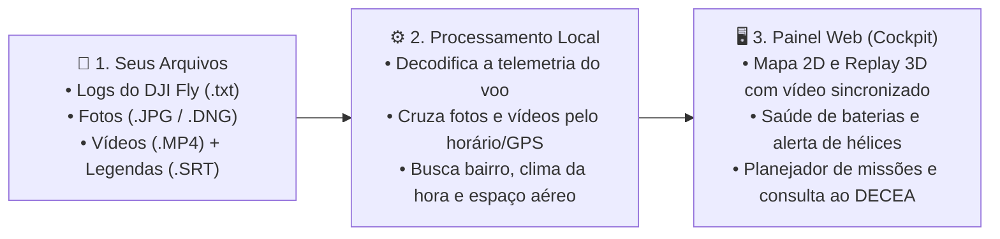

# Drone Manager (DJI Mini 3 · Telemetria & SIG)

Sistema de Informação Geográfica (SIG) e cockpit web local de telemetria para gerenciar voos, fotos, vídeos, detecção de objetos e manutenção de drones **DJI Mini 3** (e outros modelos DJI, como Phantom 4, via metadados EXIF/XMP/GPS e legendas `.SRT`).

---

## 1. Visão Geral

O **Drone Manager** processa localmente os arquivos de log do aplicativo DJI Fly (`DJIFlightRecord_*.txt`, além de `.csv` Litchi/Airdata, `.ulg` PX4 e `.bin` ArduPilot), fotos (`.jpg`, `.jpeg`, `.dng`), vídeos (`.mp4`, `.mov`) e trilhas de legenda (`.SRT`), consolidando tudo em um banco SQLite local (`data/drone.db`). A interface web em estilo **DJI Cockpit** (com alternância de **Tema Claro / Escuro**) oferece mapas 2D (Leaflet), replay 3D sobre terreno real (CesiumJS), instrumentos de voo em tempo real, fotogrametria (Footprint/GSD), visualizador 360° (Pannellum), detecção aérea de objetos (YOLO11s VisDrone via ONNX) e consulta ao espaço aéreo brasileiro (DECEA / GEOAISWEB).

---

## 2. Como Funciona

O **Drone Manager** roda 100% no seu computador (sem enviar suas fotos ou vídeos para a nuvem) e transforma os arquivos brutos do drone em um painel interativo em **3 passos simples**:



1. **Leitura automática dos seus arquivos:** Você aponta a pasta onde salva as fotos/vídeos do cartão SD (ou HD externo) e envia os logs de voo do celular (`DJIFlightRecord_*.txt`).
2. **Cruzamento inteligente:** O sistema lê o GPS e o horário de cada foto/vídeo, associa automaticamente cada mídia ao voo correspondente, descobre o bairro/cidade onde você decolou e busca como estava o clima (vento, temperatura e chuva) no momento do voo.
3. **Visualização estilo Cockpit:** No navegador, você assiste ao replay do voo em 2D ou 3D sincronizado com o vídeo gravado pelo drone, acompanha o desgaste real das baterias e hélices e consulta áreas restritas do **DECEA** antes de sair para voar.

---

## 3. Instalação Fácil (Guia Rápido para Iniciantes)

Nunca usou terminal ou Python? Siga os passos abaixo copiando e colando um comando por vez.

### Passo 1 — Abrir o Terminal (Linux ou Windows 11 com WSL2)
- **No Linux (Ubuntu/Debian):** Abra o aplicativo **Terminal**.
- **No Windows 11:** Abra o **Ubuntu (WSL2)** pelo Menu Iniciar.
  > *Se ainda não tiver o WSL2 instalado no Windows 11, abra o PowerShell como Administrador, execute `wsl --install` e reinicie o computador.*

### Passo 2 — Baixar o projeto e instalar os programas auxiliares
No terminal, entre na pasta onde deseja salvar o projeto (por exemplo, na sua pasta pessoal) e instale os utilitários de sistema (`python3-venv`, `exiftool`, `ffmpeg` e `cargo`):

```bash
git clone <URL_DO_REPOSITORIO> ~/drone-manager
cd ~/drone-manager
sudo apt update && sudo apt install -y python3 python3-venv python3-pip libimage-exiftool-perl ffmpeg cargo
```

Em seguida, instale o decodificador oficial de logs da DJI (`dji-log`):

```bash
cargo install --git https://github.com/lvauvillier/dji-log-parser dji-log-cli
```
*(O binário `dji-log` será salvo automaticamente em `~/.cargo/bin/dji-log`.)*

### Passo 3 — Criar o ambiente Python e instalar as bibliotecas
Ainda dentro da pasta `~/drone-manager`, crie um ambiente isolado (`.venv`) e instale as dependências listadas em [`requirements.txt`](requirements.txt):

```bash
python3 -m venv .venv
source .venv/bin/activate
pip install -r requirements.txt
```

### Passo 4 — Configurar o arquivo `.env` (o que é obrigatório vs. opcional)
Copie o modelo [`.env.example`](.env.example) para `.env` e proteja as permissões do arquivo:

```bash
cp .env.example .env
chmod 600 .env
```

Você pode editar o `.env` com `nano .env` (pressione `Ctrl+O` e `Enter` para salvar, e `Ctrl+X` para sair). Veja o que realmente precisa preencher:

- **Funciona sem nenhuma chave:** O aplicativo já abre e funciona para organizar fotos e vídeos, ler GPS/EXIF e legendas `.SRT`, exibir mapas 2D, planejar missões, consultar o DECEA e rodar a detecção de objetos.
- **`DJI_API_KEY` *(Opcional — gratuita)*:** Só é necessária se você quiser importar logs de voo `.txt` criptografados (versão v13+) do app DJI Fly. A chave é obtida gratuitamente no portal DJI Developer (Open API).
- **`CESIUM_TOKEN` *(Opcional — gratuito)*:** Só é necessário se você quiser usar o relevo 3D mundial no modo **Replay 3D** (CesiumJS). O mapa 2D funciona normalmente sem esse token.

### Passo 5 — Iniciar o servidor
Execute o script de inicialização:

```bash
./start.sh
```

Quando aparecer a mensagem de que o servidor está rodando, abra o navegador e acesse:
**http://127.0.0.1:8000**

### Passo 6 *(Opcional — apenas Windows 11 + WSL2)* — Criar atalho com ícone na Área de Trabalho
Para não precisar abrir o terminal toda vez, crie um atalho oficial do **Drone Manager** na sua Área de Trabalho rodando este comando no terminal do WSL2:

```bash
powershell.exe -NoProfile -ExecutionPolicy Bypass -File "$(wslpath -w ~/drone-manager/windows/criar-atalho.ps1)"
```

Esse comando usa [`windows/criar-atalho.ps1`](windows/criar-atalho.ps1) para copiar o launcher [`windows/DroneManager.ps1`](windows/DroneManager.ps1) e o ícone `windows/drone.ico` para `%LOCALAPPDATA%\DroneManager`. Ao clicar duas vezes no atalho **Drone Manager**, ele verifica se o servidor já está ativo na porta `8000`, sobe o `./start.sh` no WSL2 automaticamente caso não esteja e abre o navegador em `http://localhost:8000`.

---

## 4. Estrutura de Pastas

```text
drone-manager/
├── app.py                  # Backend FastAPI, migrações SQLite, parsers e rotas REST
├── static/
│   └── index.html          # Frontend SPA (DJI Cockpit, Leaflet, Chart.js, CesiumJS, Pannellum)
├── data/
│   ├── drone.db            # Banco de dados SQLite local
│   ├── logs/               # Arquivos DJIFlightRecord_*.txt copiados do celular
│   ├── logs_ignorados/     # Logs sem decolagem ou corrompidos
│   ├── media/              # Pasta padrão local para fotos/vídeos/.SRT
│   ├── models/             # Cache do modelo ONNX de detecção aérea (yolo11s_visdrone.onnx)
│   └── thumbs/             # Cache de miniaturas JPEG (400px) e clipes HUD temporários
├── .agent/                 # Regras e skills de agentes especialistas para desenvolvimento
├── .env.example            # Modelo documentado de variáveis de ambiente (sem segredos)
├── .gitignore              # Proteção contra commit de .env, banco, logs de voo, mídias e cache
├── requirements.txt        # Dependências Python com versões mínimas/compatíveis
├── start.sh                # Script de inicialização segura (127.0.0.1:8000)
├── backup.sh               # Script de backup incremental para HD externo (aceita --no-pause)
├── windows/
│   ├── DroneManager.ps1    # Launcher inteligente que sobe o WSL2 e abre o navegador
│   ├── criar-atalho.ps1    # Gerador do atalho "Drone Manager.lnk" na Área de Trabalho
│   └── drone.ico           # Ícone oficial do aplicativo para Windows
├── GEMINI.md               # Documentação arquitetural e regras de contexto para IA
└── README.md               # Este guia de instalação, arquitetura e uso
```

---

## 5. Configuração de Variáveis de Ambiente

Todas as variáveis podem ser configuradas no arquivo `.env` (baseado em [`.env.example`](.env.example)):

| Variável | Padrão no Código | Obrigatória | Descrição |
| :--- | :---: | :---: | :--- |
| `DJI_API_KEY` | `""` | **Sim** *(logs v13+)* | Chave gratuita da DJI Developer para decodificar arquivos `.txt` no `dji-log`. |
| `CESIUM_TOKEN` | `""` | **Sim** *(Replay 3D)* | Token gratuito do Cesium Ion para terreno 3D mundial (`CesiumWorldTerrain`). |
| `TZ_OFFSET` | `-3` | Não | Fuso horário local em horas em relação ao UTC (ex.: `-3` Brasília/Rio). |
| `LOGS_DIR` | `data/logs` | Não | Pasta onde ficam os arquivos `DJIFlightRecord_*.txt`. |
| `MEDIA_DIR` | `data/media` *(no `.env.example`: `/mnt/e/DJI`)* | Não | Pasta principal padrão de fotos, vídeos e `.SRT` (aceita caminhos WSL `/mnt/...` ou locais). |
| `BACKUP_DIR` | `""` *(no `backup.sh`: `/mnt/e/Backup_DroneManager`)* | Não | Pasta de destino para backup e verificação de mídias já copiadas. |
| `AIRSPACE_TILES` | `""` | Não | URL opcional de tiles XYZ extras de espaço aéreo. |
| `PROP_LIMIT_H` | `50` | Não | Limite de horas acumuladas para aviso de troca de hélices. |
| `DJI_LOG_BIN` | `dji-log` | Não | Nome ou caminho completo do binário `dji-log`. |
| `HOST` / `PORT` | `127.0.0.1` / `8000` | Não | Endereço e porta usados pelo [`start.sh`](start.sh) ao iniciar o `uvicorn`. |

---

## 6. Uso Diário e Backup

### Primeiros Passos no Cockpit
1. **Importar voos:** Na aba **Voos**, clique em **`⬆ Enviar logs`** para enviar arquivos `DJIFlightRecord_*.txt`, `.csv` (Litchi/Airdata), `.ulg` (PX4) ou `.bin` (ArduPilot) — ou copie-os manualmente para `data/logs/`.
2. **Importar do Cartão SD (opcional):** Na aba **Configurações**, use o **Importador de Cartão SD** para detectar cartões montados, pré-visualizar mídias novas (ignorando duplicados por hash SHA-1), organizar automaticamente em pastas `YYYY-MM-DD_Local` com seus `.SRT` e rodar o scan.
3. **Cadastrar pastas de mídia:** Na aba **Configurações**, adicione suas pastas de fotos/vídeos (suporta caminhos Windows `E:\DJI` ou Linux/WSL `/mnt/e/DJI`).
4. **Escanear biblioteca:** Clique em **Escanear pastas** no menu lateral esquerdo para indexar EXIF, `.SRT`, gerar miniaturas e vincular fotos/vídeos aos voos.
5. **Atualizar logs antigos:** Caso tenha logs importados anteriormente sem telemetria completa, clique em **`⟳ Atualizar telemetria dos logs`** na aba **Voos**.

### Executar Backup para HD Externo
Você pode disparar o backup direto pela interface web (**Configurações** → **💾 Fazer Backup Agora**) ou pelo terminal:

```bash
./backup.sh
```

O script [`backup.sh`](backup.sh) copia logs novos, gera um backup atômico e consistente do SQLite (`drone-YYYY-MM-DD.db`, mantendo as **10 cópias mais recentes**) e salva os arquivos de código e configuração em `/mnt/e/Backup_DroneManager` (ou no caminho definido em `BACKUP_DIR`, sem copiar segredos do `.env`). Para automação sem pausa ao final, use `./backup.sh --no-pause`.

---

## 7. Principais Funcionalidades e Atalhos

- **Menu Lateral de Operações Rápidas:**
  - **Planejar missão pré-voo (Rota Livre, Grade, Grade Dupla 3D e Órbita POI):** Desenhe rotas manuais ou polígonos/órbitas no mapa para gerar automaticamente *waypoints* em zigue-zague com cálculo de **GSD desejado** (sincronizado com a altitude), **sobreposição frontal/lateral**, ângulo automático, estimativa de fotos, **divisão por bateria**, alcance VLOS (`H`), checagem no DECEA e exportação em **KMZ nativo DJI (WPML)**, **KML**, **GPX** e **GeoJSON**.
  - **Consultar espaço aéreo:** Ativa a mira de inspeção direta no GeoServer do DECEA/GEOAISWEB ao clicar em qualquer ponto do mapa geral ou do mapa de detalhe do voo.
  - **Previsão de janela de voo ("Posso Voar?"):** Consulta previsão horária de 1 a 7 dias via Open-Meteo (vento a 10m, 80m e 120m, rajadas, chuva, nuvens, visibilidade, nascer/pôr do sol) e índice geomagnético **Kp** (NOAA SWPC), gerando semáforo por hora (🟢/🟡/🔴/🌙) e resumo das melhores janelas diurnas a partir do mapa, do planejador pré-voo ou da aba Locais.
  - **Busca em Linguagem Natural (sem IA externa):** Interpreta consultas em português como *"voos acima de 80 m em 2025"*, *"fotos sem voo"* ou *"voos perto de aeroporto"*.
- **Mapa Geral, Motor Espacial GIS & Fotogrametria (`📐 Footprint / GSD`):**
  - Polilinhas dos voos (otimizadas via Ramer-Douglas-Peucker), clusters de fotos, projeção do polígono real coberto por cada foto no solo, cálculo de **GSD (`cm/pixel`)** e **% de sobreposição**, e camadas WMS do DECEA.
  - **Motor Espacial Nível 1 + Nível 2 no SQLite:** Índices espaciais 2D nativos **SQLite R-Tree** (`rtree_flights` com o envelope completo de cada rota, `rtree_media`, `rtree_spots`) + funções geodésicas e cartográficas **SpatiaLite / GEOS / PROJ** (`ST_Distance_Sphere`, `ST_MakePointGeoJSON`, `ST_MakeEnvelopeGeoJSON`, `ST_UTM_EPSG`, `ST_Area_UTM`) com filtro instantâneo por janela visível (`📐 Filtrar nesta área do mapa`).
- **Cockpit HUD ao Vivo, Saúde do Voo e Coloração Dinâmica da Rota no Replay 2D/3D:**
  - **Player Sincronizado (Vídeo + Mapa 2D/3D + Gráfico):** Exibe o vídeo do drone lado a lado com o mapa **2D (Leaflet)** ou **3D (CesiumJS** com terreno real, parede vertical, cone de visão 3D da câmera e miniaturas das fotos ao longo da rota), sincronizando o cursor no mapa e no gráfico `Chart.js` com o instante do vídeo. Inclui velocidades de `0.5×` a `8×`, ajuste fino de sincronia (`-5s`, `-1s`, `+1s`, `+5s` salvo por vídeo), câmeras 3D (`Seguir`, `Geral`, `Topo`) e **Modo Tela Cheia** com o vídeo em Picture-in-Picture (PiP) flutuante.
  - **Índice de Saúde do Voo (*Flight Health Score* `0–100`):** Nota diagnóstica automática por voo (🟢 `≥ 85 Excelente`, 🟡 `65–84 Atenção`, 🔴 `< 65 Crítico`) cruzando 3 sub-notas: **Mecânica & Sensores** (`vib_s`, `force_s`, `comp_s`, `gimb_s`), **Bateria & Elétrica** (queda brusca de tensão sob carga / *voltage sag* em `mV`, tensão mínima por célula, desvio entre células, temperatura e pouso crítico) e **Link RC & GPS** (segundos com sinal RC fraco ou `< 8` satélites), exibida na tabela de voos (ordenável), no cartão de detalhe e no relatório PDF.
  - **Coloração Dinâmica da Rota por Telemetria:** Seletor no mapa do voo (2D e 3D) para colorir o trajeto em gradiente por **Sinal RC (`%`)**, **Altitude**, **Velocidade**, **Satélites GPS**, **Consumo (`W`)** ou **Bateria (`%`)**, com legenda de escala mín./máx., *tooltip* ao passar o mouse e clique direto no trecho para saltar ao instante do voo.
  - **Joysticks do Controle Remoto (RC Sticks):** Movimento em tempo real dos dois sticks (`Acel./Giro` e `Frente/Lado`), **Sinal RC (%)** e **Satélites**.
  - **Horizonte Artificial (SVG):** Indicador dinâmico de `Pitch` e `Roll`, `Proa (Yaw)`, `Gimbal` e `Velocidade Vertical (m/s)`.
  - **Telemetria Elétrica:** Potência instantânea (`W`), tensão (`V`), corrente (`A`), tensão individual por célula (`C1`, `C2`...) e gráfico comutável (**Voo** vs **Elétrica**).
  - **Ponto Home (`H`) e Limite VLOS (500 m):** Marcador `H`, linha tracejada ao vivo `Home ↔ Drone` e alerta de distância VLOS.
- **Extração de Coordenada Geográfica do Frame (`📍 Coordenada do frame`):**
  - Extrai a coordenada GPS exata do frame exibido no vídeo/replay (via `.SRT` ou interpolação da trilha do voo) e calcula também a **coordenada estimada do Alvo da Câmera no Solo**, gerando botões diretos para **`🗺 Abrir no Google Maps ↗`**, copiar ou salvar nos Locais Favoritos.
- **Exportador de Clipe MP4 com HUD Embutido (`🎬 Exportar clipe com HUD`):** Renderiza via `ffmpeg` um trecho do vídeo com telemetria DJI gravada na imagem (com limpeza automática de arquivos temporários em background).
- **Integração Local com NodeODM / WebODM, Ortomosaicos GeoTIFF & Medições Geodésicas (`Ortomosaicos` no menu):** Envia fotos selecionadas da galeria ou de um voo direto para uma instância local do **NodeODM** (`http://127.0.0.1:3000`), permite iniciar/parar o container Docker local (`drone-manager-nodeodm`) em 1 clique quando offline, acompanha o progresso em tempo real e importa arquivos **GeoTIFF** grandes direto pelo caminho no disco (com leitura em faixas/blocos de baixo uso de RAM e barra de `%`) como camada sobreposta no mapa Leaflet com controle de opacidade, download do `.tif`, além de **medições geodésicas de distância/área e pinos de inspeção** com exportação **GeoJSON** e relatório HTML/PDF.
- **Timeline Contínua de Multi-Clipes no Voo (e Unificação Opcional `.MP4`):** Quando um voo possui múltiplos vídeos (como splits de 4 GB ou gravações separadas), a barra de replay exibe os segmentos de cada clipe na linha do tempo e alterna automaticamente entre eles durante a reprodução (avançando também nos intervalos sem gravação). Opcionalmente, o usuário pode unificar os clipes selecionados sem perda (`ffmpeg -c copy`, preservando os originais) apenas para download ou salvamento na pasta do voo.
- **Exportação, Relatórios & Reconstrução Automática de Voos:**
  - Exporta cada voo em **KML**, **GPX**, **GeoJSON (RFC 7946)**, **Relatório HTML/PDF** para impressão e **Pacote Portátil HTML Offline** (auto-contido para envio a clientes ou auditoria), além do **Livro de Bordo completo em CSV** (`/api/logbook.csv`).
  - **Reconstrução Automática de Voos:** Para fotos antigas com GPS anteriores ao primeiro log registrado, agrupa imagens por proximidade temporal/espacial (`reconstruct_flights`) ou via trilhas `.SRT` para reconstruir voos aproximados no mapa.
- **Painel de Estatísticas, Saúde das Baterias & Manutenção (`Estatísticas`):**
  - **Painel Geral:** Filtro por ano, **Calendário de Voos em SVG estilo GitHub** (clicável para filtrar os voos do dia), gráficos de horário de decolagem, dia da semana e distribuição de duração, cartões de voos recordistas e **Mapa de Calor (`leaflet.heat`)** das rotas e decolagens.
  - **Saúde das Baterias & Hélices:** Tabela diagnóstica por serial de bateria (voos, horas, capacidade atual em mAh, % de queda, desvio máximo entre células em mV e temperatura máxima) com gráficos de evolução temporal, barra de desgaste das hélices (`PROP_LIMIT_H`) com botão de reset e detector de arquivos **duplicados por hash SHA-1**.
- **Locais Favoritos, Busca de Endereço & Importador de Cartão SD:**
  - Clique com o botão direito no mapa para salvar **Locais Favoritos** (gerenciados na aba **Locais**) e busque endereços/cidades diretamente pelo **Geocoding (Nominatim)**.
  - **Importador Inteligente de Cartão SD:** Detecta cartões/discos montados, identifica arquivos inéditos via SHA-1, agrupa automaticamente em pastas `YYYY-MM-DD_Local`, copia mídias + `.SRT` e executa o scan.
- **Detecção Aérea de Objetos (`YOLO11s VisDrone ONNX`):** Analisa fotos e frames de vídeo localmente via `onnxruntime`, identifica 10 classes aéreas (pedestre, carro, van, caminhão, ônibus, moto, bicicleta, etc.), aplica tags automáticas `ia:*` e gera relatórios filtráveis em HTML/JSON.
- **Busca Semântica Local em Fotos (`CLIP ViT-B/32 ONNX`):** Indexa fotos localmente em `512` dimensões no SQLite (`clip_emb`) e permite buscar imagens por descrição visual offline em português ou inglês (ex.: *"praia pôr do sol"*, *"barco"*, *"telhado"*, *"lagoa"*), exibindo a pontuação de similaridade.
- **Galeria Inteligente, Comparação Temporal e Visualizador 360° (`Pannellum`):** Filtros para fotos/vídeos **Verticais `9:16` (Modo Retrato do Mini 3)**, **Horizontais**, **Panoramas `360°`** e **`4K`**, visualizador esférico 360° interativo no modal, **Comparação Temporal (*Before / After*)** com slider divisor (*split view*) entre 2 fotos da galeria ou fotos próximas no mesmo GPS/ângulo (`/api/media/{id}/nearby`) e opção de **remover mídias apenas da galeria** ou **apagar permanentemente do HD** (individualmente no modal ou em lote pelos itens marcados).
- **Segurança Local-First:**
  - Servidor restrito ao *loopback* local (`127.0.0.1`), protegido por `TrustedHostMiddleware`, validação estrita de `Origin`/`Referer` e `Sec-Fetch-Site: cross-site` contra CSRF em métodos mutáveis (`POST`/`PUT`/`PATCH`/`DELETE`), cabeçalhos `Content-Security-Policy` (CSP), `X-Content-Type-Options: nosniff` e `X-Frame-Options: SAMEORIGIN`, hashes SRI (`SHA-384`) nas bibliotecas CDN, sanitização contra *CSV Injection* e XSS, e bloqueio *case-insensitive* de diretórios sensíveis do Windows no WSL2 (`/mnt/c/windows`, `/mnt/c/users`, `/mnt/c/program files`, `/mnt/c/programdata`).
  - Banco SQLite em modo **WAL** (`journal_mode=WAL`, `busy_timeout=30000`) com fechamento explícito de conexões e proteção contra perda de status de backup quando o HD externo está desconectado.
- **Suporte Multilíngue (i18n), Unidades Imperiais & Tema Claro/Escuro:**
  - Botão na barra lateral para alternar entre **Tema Escuro (*DJI Cockpit*)** e **Tema Claro**.
  - Seletor de idioma na barra lateral e em Configurações para **Português (BR)**, **English** e **Español** (`static/i18n/{pt-BR,en,es}.json`), com persistência em `localStorage` e no SQLite (`/api/lang`).
  - Em **English**, as medidas de telemetria, mapas, estatísticas e relatórios HTML/PDF são convertidas automaticamente para o **sistema imperial** (`ft`, `mi`, `mph`, `ft/s`, `°F`); em Português e Español, permanecem no sistema métrico (`m`, `km`, `km/h`, `m/s`, `°C`).
  - A busca em linguagem natural (`nlParse`) também reconhece expressões em português, inglês e espanhol (incluindo `ft`, `mi` e `mph`).
- **Atalhos de Teclado:**
  - `Espaço`: Pausar / Reproduzir o replay na tela de detalhe do voo.
  - `←` / `→`: Retroceder ou avançar 5 segundos no replay do voo (ou deslizar o divisor *Before / After* no comparador de fotos).
  - `Esc`: Fechar o modal de foto/vídeo/360°/comparador ou a barra de coordenada capturada.

---

## 8. Endpoints Principais da API REST (`app.py`)

| Método | Rota | Descrição |
| :---: | :--- | :--- |
| `POST` | `/api/scan?force=0\|1` | Importa logs (`.txt` DJI, `.csv` Litchi/Airdata, `.ulg` PX4, `.bin` ArduPilot), indexa mídias/EXIF/XMP/SRT, vincula mídias a voos e reconstrói voos. |
| `POST` | `/api/logs/upload?name=...` | Recebe arquivos de log (`.txt`, `.csv`, `.ulg`, `.bin`) via streaming pelo navegador e importa automaticamente. |
| `GET` | `/api/flights` | Lista voos com filtros (texto, datas, altura, duração, bateria, aeronave, origem, favoritos). |
| `GET` | `/api/flights/{fid}` | Detalhe completo do voo, incluindo `track` (15 posições/s), `events`, `bat`, `air` e `meta`. |
| `POST` | `/api/flights/{fid}/airspace-check` | Consulta WFS no GeoServer do DECEA (GEOAISWEB) para o trajeto do voo. |
| `GET` | `/api/flights/{fid}/kml` \| `/gpx` \| `/geojson` \| `/report` \| `/package` | Exporta a rota do voo em KML, GPX, GeoJSON (RFC 7946), relatório HTML/PDF ou **Pacote Portátil HTML offline** para cliente/auditoria. |
| `GET` | `/api/logbook.csv` | Exporta o livro de bordo completo em CSV (com proteção contra *CSV Injection*). |
| `GET/POST/DELETE` | `/api/missions`, `/elevation` & `/{mid}/airspace-check` | Planejador de Missões Pré-Voo (waypoints, perfil de elevação DEM / *Terrain Follow*, estimativa de bateria/VLOS, checagem DECEA e exportação KMZ WPML/KML/GPX/GeoJSON). |
| `GET` | `/api/weather/forecast?lat=...&lon=...&days=3` | Previsão horária de janela de voo (Open-Meteo: vento em altitude, rajadas, chuva, visibilidade + índice Kp NOAA). |
| `GET` | `/api/media` | Lista fotos/vídeos com filtros de orientação (`portrait`, `landscape`, `pano`, `4k`), tags e raio GPS. |
| `GET` | `/api/media/{mid}/nearby` | Lista fotos próximas à coordenada GPS de uma foto base (`radius_m`), ordenadas por distância e ângulo (`Δyaw`). |
| `DELETE` / `POST` | `/api/media/{mid}?disk=0\|1` & `/api/media/delete-batch` | Remove mídia(s) apenas da galeria/banco ou também apaga o(s) arquivo(s) do HD (com validação de pasta permitida). |
| `GET` | `/api/media/{mid}/srt` | Retorna a trilha segundo a segundo do arquivo `.SRT` do vídeo (GPS, altitude e câmera). |
| `GET` | `/api/media/{mid}/hud-video` | Gera e baixa via `ffmpeg` um clipe `.mp4` com HUD de telemetria embutido. |
| `POST` | `/api/flights/{fid}/merge-videos` | Opcional: unifica clipes `.mp4` selecionados do voo sem perda (`-c copy`) para download ou salvamento local (originais preservados). |
| `POST` | `/api/media/{mid}/detect` & `/api/detect/batch` | Executa detecção aérea de objetos (YOLO11s VisDrone ONNX) em uma mídia ou em lote. |
| `GET/POST` | `/api/media/semantic-status`, `/semantic-index`, `/semantic-search` | Indexação local e busca semântica visual em fotos via CLIP ViT-B/32 ONNX offline. |
| `GET` | `/api/detections/report` | Gera relatório consolidado das detecções (HTML ou JSON), filtrável por voo e classe. |
| `GET` | `/api/export/photos` | Exporta fotos selecionadas em arquivo `.zip` (pronto para fotogrametria/OpenDroneMap). |
| `GET` | `/api/stats`, `/api/battery-health` & `POST /api/props/reset` | Estatísticas gerais, frota de drones, saúde das baterias e reset do contador de hélices. |
| `GET/POST/DELETE` | `/api/spots` & `GET /api/geocode` | Gerenciamento de Locais Favoritos no mapa e busca de endereços via Nominatim. |
| `GET/POST` | `/api/sd/detect`, `/preview` & `/import` | Detecção de cartão SD, pré-visualização por data/local/SHA-1 e importação organizada com `.SRT`. |
| `GET/POST/PATCH/DELETE` | `/api/roots` & `/api/fs/list` | Gerenciamento seguro de pastas de mídia (`media_roots`) restrito a discos montados (`/mnt`, `/media`, `/run/media`, `/Volumes`) e `data/media`. |
| `POST` | `/api/backup` | Executa `backup.sh --no-pause` para copiar logs, banco SQLite e código para o HD externo. |
| `GET/POST` | `/api/gis/status` & `/api/gis/rebuild` | Diagnóstico e reconstrução do motor espacial GIS (Nível 1: SQLite R-Tree 2D + B-Tree; Nível 2: SpatiaLite / GEOS / PROJ). |
| `GET/POST` | `/api/lang` | Lê ou salva o idioma ativo (`pt-BR`, `en`, `es`) na tabela `kv` do SQLite. |
| `GET/POST/DELETE` | `/api/odm/status`, `/start`, `/stop` & `/api/orthos/*` | Integração local com **NodeODM** (controle de container Docker local, envio de fotos, progresso, cancelamento, importação em *streaming* de **GeoTIFF** por caminho/upload e camada PNG/TIF no mapa). |
| `GET/POST/DELETE` | `/api/annotations` & `/geojson` \| `/report` | Medição geodésica de distância/área e pinos de inspeção sobre ortomosaicos, com exportação **GeoJSON** e relatório HTML/PDF. |

---

## 9. Repositórios e Serviços Open-Source Utilizados

1. **Parser de Logs em Rust:**
   - **[lvauvillier/dji-log-parser](https://github.com/lvauvillier/dji-log-parser)** (`dji-log-cli` / binário `dji-log`)
2. **Bibliotecas Frontend (CDN em [`static/index.html`](static/index.html)):**
   - **[Leaflet/Leaflet](https://github.com/Leaflet/Leaflet)** (`v1.9.4`)
   - **[Leaflet/Leaflet.markercluster](https://github.com/Leaflet/Leaflet.markercluster)** (`v1.5.3`)
   - **[Leaflet/Leaflet.heat](https://github.com/Leaflet/Leaflet.heat)** (`v0.2.0`)
   - **[chartjs/Chart.js](https://github.com/chartjs/Chart.js)** (`v4.4.1`)
   - **[CesiumGS/cesium](https://github.com/CesiumGS/cesium)** (`v1.145`)
   - **[mpetroff/pannellum](https://github.com/mpetroff/pannellum)** (`v2.5.6`)
3. **Bibliotecas Backend em Python ([`requirements.txt`](requirements.txt)):**
   - **[fastapi/fastapi](https://github.com/fastapi/fastapi)** (com **[encode/starlette](https://github.com/encode/starlette)** e **[pydantic/pydantic](https://github.com/pydantic/pydantic)**)
   - **[encode/uvicorn](https://github.com/encode/uvicorn)**
   - **[python-pillow/Pillow](https://github.com/python-pillow/Pillow)**
   - **[microsoft/onnxruntime](https://github.com/microsoft/onnxruntime)** & **[numpy/numpy](https://github.com/numpy/numpy)**
4. **Ferramentas CLI e Serviços Externos:**
   - **[exiftool/exiftool](https://github.com/exiftool/exiftool)** · **[FFmpeg/FFmpeg](https://github.com/FFmpeg/FFmpeg)** · **[osm-search/Nominatim](https://github.com/osm-search/Nominatim)** · **[open-meteo/open-meteo](https://github.com/open-meteo/open-meteo)** · **NOAA SWPC** (índice geomagnético Kp) · **[geoserver/geoserver](https://github.com/geoserver/geoserver)** (DECEA / GEOAISWEB).
