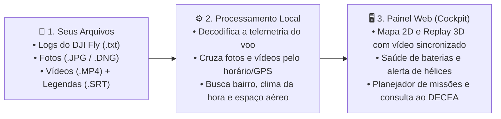

# Drone Manager (DJI Mini 3 · Telemetria & SIG)

Sistema de Informação Geográfica (SIG) e cockpit web local de telemetria para gerenciar voos, fotos, vídeos e manutenção de drones **DJI Mini 3** (e outros modelos DJI, como Phantom 4, via metadados EXIF/XMP/GPS e legendas `.SRT`).

---

## 1. Visão Geral

O **Drone Manager** processa localmente os arquivos de log criptografados do aplicativo DJI Fly (`DJIFlightRecord_*.txt`), fotos (`.jpg`, `.jpeg`, `.dng`), vídeos (`.mp4`, `.mov`) e trilhas de legenda (`.SRT`), consolidando tudo em um banco SQLite local (`data/drone.db`) e oferecendo uma interface web em estilo **DJI Cockpit** com mapas 2D (Leaflet), replay 3D sobre terreno real (CesiumJS), instrumentos de voo em tempo real, fotogrametria (Footprint/GSD), visualizador 360° (Pannellum) e consulta ao espaço aéreo brasileiro (DECEA / GEOAISWEB).

---

## 2. Como Funciona

O **Drone Manager** roda 100% no seu computador (sem enviar suas fotos ou vídeos para a nuvem) e transforma os arquivos brutos do drone em um painel interativo em **3 passos simples**:



1. **Leitura automática dos seus arquivos:** Você aponta a pasta onde salva as fotos/vídeos do cartão SD (ou HD externo) e envia os logs de voo do celular (`DJIFlightRecord_*.txt`).
2. **Cruzamento inteligente:** O sistema lê o GPS e o horário de cada foto/vídeo, associa automaticamente cada mídia ao voo correspondente, descobre o bairro/cidade onde você decolou e busca como estava o clima (vento, temperatura e chuva) no momento do voo.
3. **Visualização estilo Cockpit:** No navegador, você assiste ao replay do voo em 2D ou 3D sincronizado com o vídeo gravado pelo drone, acompanha o desgaste real das baterias e hélices e consulta áreas restritas do **DECEA** antes de sair para voar.

---

## 3. Estrutura de Pastas

```text
drone-manager/
├── app.py                  # Backend FastAPI, migrações SQLite, parsers e rotas REST
├── static/
│   └── index.html          # Frontend SPA (DJI Cockpit, Leaflet, Chart.js, CesiumJS, Pannellum)
├── data/
│   ├── drone.db            # Banco de dados SQLite local
│   ├── logs/               # Arquivos DJIFlightRecord_*.txt copiados do celular
│   ├── logs_ignorados/     # Logs sem decolagem ou corrompidos
│   ├── media/              # Pasta padrão local para fotos/vídeos/.SRT
│   └── thumbs/             # Cache de miniaturas JPEG (400px) e clipes HUD temporários
├── .agent/                 # Regras globais, workflow de auditoria (full-audit.md) e skills de agentes especialistas
├── .env.example            # Modelo documentado de variáveis de ambiente (sem segredos)
├── .gitignore              # Proteção contra commit de .env, banco, logs de voo, mídias e cache
├── requirements.txt        # Dependências Python com versões fixadas
├── start.sh                # Script de inicialização segura (127.0.0.1:8000)
├── backup.sh               # Script de backup incremental para HD externo
├── GEMINI.md               # Documentação arquitetural e regras de contexto para IA
└── README.md               # Este guia de instalação, arquitetura e uso
```

---

## 4. Pré-requisitos e Instalação

1. **Python 3.9+ e Ambiente Virtual:**
   ```bash
   python3 -m venv .venv
   source .venv/bin/activate
   pip install -r requirements.txt
   ```
2. **Ferramentas de Linha de Comando (`exiftool` e `ffmpeg`):**
   ```bash
   sudo apt update && sudo apt install -y libimage-exiftool-perl ffmpeg
   ```
3. **Parser de Logs DJI (`dji-log-cli` via Rust/Cargo):**
   ```bash
   cargo install --git https://github.com/lvauvillier/dji-log-parser dji-log-cli
   ```
   *(O binário `dji-log` será instalado em `~/.cargo/bin/dji-log`).*
4. **Chaves Gratuitas de API:**
   - **DJI Developer (Open API):** Necessária para descriptografar logs de voo v13+.
   - **Cesium Ion (`CESIUM_TOKEN`):** Necessária para carregar o relevo 3D mundial (`CesiumWorldTerrain`) no replay 3D.

---

## 5. Configuração de Variáveis de Ambiente

Copie o arquivo [`.env.example`](file:///home/dudu/drone-manager/.env.example) para `.env` e restrinja suas permissões:

```bash
cp .env.example .env
chmod 600 .env
```

| Variável | Padrão | Obrigatória | Descrição |
| :--- | :---: | :---: | :--- |
| `DJI_API_KEY` | `""` | **Sim** (logs v13+) | Chave da DJI Developer para decodificar arquivos `.txt` no `dji-log`. |
| `CESIUM_TOKEN` | `""` | **Sim** (Replay 3D) | Token do Cesium Ion para terreno 3D mundial. |
| `TZ_OFFSET` | `-3` | Não | Fuso horário local em horas em relação ao UTC (ex.: `-3` Brasília/Rio). |
| `LOGS_DIR` | `data/logs` | Não | Pasta onde ficam os arquivos `DJIFlightRecord_*.txt`. |
| `MEDIA_DIR` | `/mnt/e/DJI` | Não | Pasta principal padrão de fotos, vídeos e `.SRT`. |
| `BACKUP_DIR` | `""` | Não | Pasta de backup para checagem de mídias já copiadas. |
| `AIRSPACE_TILES` | `""` | Não | URL opcional de tiles XYZ extras de espaço aéreo. |
| `PROP_LIMIT_H` | `50` | Não | Limite de horas acumuladas para aviso de troca de hélices. |
| `DJI_LOG_BIN` | `dji-log` | Não | Nome ou caminho do binário `dji-log`. |

---

## 6. Como Executar e Fazer Backup

### Iniciar o Servidor
```bash
./start.sh
```
Abra **http://127.0.0.1:8000** no navegador.

1. Importe seus logs `DJIFlightRecord_*.txt` clicando em **`⬆ Enviar logs (.txt)`** na aba **Voos** (ou copiando-os para `data/logs/`).
2. Na aba **Configurações**, adicione suas pastas de fotos/vídeos (suporta caminhos Windows `E:\DJI` ou WSL `/mnt/e/DJI`).
3. Clique em **Escanear pastas** no menu lateral esquerdo.
4. Para atualizar logs antigos com todos os sensores do Cockpit HUD, clique em **`⟳ Atualizar telemetria dos logs`** na aba **Voos**.

### Executar Backup para HD Externo
```bash
./backup.sh
```
Copia logs novos, realiza backup atômico do SQLite (`drone-YYYY-MM-DD.db`, mantendo as 10 últimas cópias) e salva os arquivos de código/configuração em `/mnt/e/Backup_DroneManager`.

---

## 7. Principais Funcionalidades e Atalhos

- **Menu Lateral de Operações Rápidas:**
  - **Planejar missão pré-voo:** Ativa o modo de desenho de *waypoints* no mapa, calculando em tempo real distância 3D, alcance máximo VLOS (`H`), tempo estimado e consumo de bateria para o DJI Mini 3, além de verificar automaticamente o espaço aéreo no DECEA e exportar em **KML**, **GPX** e **GeoJSON**.
  - **Consultar espaço aéreo:** Ativa a mira de inspeção direta no GeoServer do DECEA/GEOAISWEB ao clicar em qualquer ponto do mapa geral ou do mapa de detalhe do voo.
- **Mapa Geral & Fotogrametria (`📐 Footprint / GSD`):** Polilinhas dos voos (otimizadas via Ramer-Douglas-Peucker), clusters de fotos, projeção do polígono real coberto por cada foto no solo, cálculo de **GSD (`cm/pixel`)** e **% de sobreposição**, e camadas WMS do DECEA.
- **Cockpit HUD ao Vivo no Replay 2D/3D:**
  - **Joysticks do Controle Remoto (RC Sticks):** Movimento em tempo real dos dois sticks (`Acel./Giro` e `Frente/Lado`), **Sinal RC (%)** e **Satélites**.
  - **Horizonte Artificial (SVG):** Indicador dinâmico de `Pitch` e `Roll`, `Proa (Yaw)`, `Gimbal` e `Velocidade Vertical (m/s)`.
  - **Telemetria Elétrica:** Potência instantânea (`W`), tensão (`V`), corrente (`A`), tensão individual por célula (`C1`, `C2`...) e gráfico comutável (**Voo** vs **Elétrica**).
  - **Ponto Home (`H`) e Limite VLOS (500 m):** Marcador `H`, linha tracejada ao vivo `Home ↔ Drone` e alerta de distância VLOS.
- **Extração de Coordenada Geográfica do Frame (`📍 Coordenada do frame`):**
  - Extrai a coordenada GPS exata do frame exibido no vídeo/replay (via `.SRT` ou interpolação da trilha do voo) e calcula também a **coordenada estimada do Alvo da Câmera no Solo**, gerando botões diretos para **`🗺 Abrir no Google Maps ↗`**, copiar ou salvar nos Locais Favoritos.
- **Exportador de Clipe MP4 com HUD Embutido (`🎬 Exportar clipe com HUD`):** Renderiza via `ffmpeg` um trecho do vídeo com telemetria DJI gravada na imagem (com limpeza automática de arquivos temporários em background).
- **Galeria Inteligente e Visualizador 360° (`Pannellum`):** Filtros para fotos/vídeos **Verticais `9:16` (Modo Retrato do Mini 3)**, **Horizontais**, **Panoramas `360°`** e **`4K`**, com visualizador esférico 360° interativo no modal.
- **Segurança Local-First:**
  - Servidor restrito ao *loopback* local (`127.0.0.1`), protegido por `TrustedHostMiddleware`, validação de `Origin`/`Referer` contra CSRF, sanitização contra *CSV Injection* e bloqueio de diretórios sensíveis do sistema (`/mnt/c/Windows`, `/mnt/c/Users`, etc.).
- **Atalhos de Teclado:**
  - `Espaço`: Pausar / Reproduzir o replay na tela de detalhe do voo.
  - `←` / `→`: Retroceder ou avançar 5 segundos no replay do voo.
  - `Esc`: Fechar o modal de foto/vídeo/360° ou a barra de coordenada capturada.

---

## 8. Endpoints Principais da API REST (`app.py`)

| Método | Rota | Descrição |
| :---: | :--- | :--- |
| `POST` | `/api/scan?force=0\|1` | Importa logs `.txt`, indexa mídias/EXIF/XMP/SRT, vincula mídias a voos e reconstrói voos. |
| `POST` | `/api/logs/upload?name=...` | Recebe arquivos `DJIFlightRecord_*.txt` via streaming pelo navegador e importa automaticamente. |
| `GET` | `/api/flights` | Lista voos com filtros (texto, datas, altura, duração, bateria, aeronave, origem, favoritos). |
| `GET` | `/api/flights/{fid}` | Detalhe completo do voo, incluindo `track` (15 posições/s), `events`, `bat`, `air` e `meta`. |
| `POST` | `/api/flights/{fid}/airspace-check` | Consulta WFS no GeoServer do DECEA (GEOAISWEB) para o trajeto do voo. |
| `GET` | `/api/flights/{fid}/kml` \| `/gpx` \| `/geojson` \| `/report` | Exporta a rota do voo em KML, GPX, GeoJSON (RFC 7946) ou relatório HTML/PDF para impressão. |
| `GET/POST/DELETE` | `/api/missions` & `/api/missions/{mid}/airspace-check` | Planejador de Missões Pré-Voo (waypoints, estimativa de bateria/VLOS, checagem DECEA e exportação KML/GPX/GeoJSON). |
| `GET` | `/api/media` | Lista fotos/vídeos com filtros de orientação (`portrait`, `landscape`, `pano`, `4k`), tags e raio GPS. |
| `GET` | `/api/media/{mid}/srt` | Retorna a trilha segundo a segundo do arquivo `.SRT` do vídeo (GPS, altitude e câmera). |
| `GET` | `/api/media/{mid}/hud-video` | Gera e baixa via `ffmpeg` um clipe `.mp4` com HUD de telemetria embutido. |
| `GET` | `/api/stats` & `/api/battery-health` | Estatísticas gerais, frota de drones, alertas mecânicos de hélices e saúde das baterias. |
| `GET/POST/PATCH/DELETE` | `/api/roots` & `/api/fs/list` | Gerenciamento seguro de pastas de mídia (`media_roots`) restrito a `/mnt` e `data/media`. |

---

## 9. Repositórios do GitHub Utilizados

1. **Parser de Logs em Rust:**
   - **[lvauvillier/dji-log-parser](https://github.com/lvauvillier/dji-log-parser)** (`dji-log-cli` / binário `dji-log`)
2. **Bibliotecas Frontend (CDN em `static/index.html`):**
   - **[Leaflet/Leaflet](https://github.com/Leaflet/Leaflet)** (`v1.9.4`)
   - **[Leaflet/Leaflet.markercluster](https://github.com/Leaflet/Leaflet.markercluster)** (`v1.5.3`)
   - **[Leaflet/Leaflet.heat](https://github.com/Leaflet/Leaflet.heat)** (`v0.2.0`)
   - **[chartjs/Chart.js](https://github.com/chartjs/Chart.js)** (`v4.4.1`)
   - **[CesiumGS/cesium](https://github.com/CesiumGS/cesium)** (`v1.145`)
   - **[mpetroff/pannellum](https://github.com/mpetroff/pannellum)** (`v2.5.6`)
3. **Bibliotecas Backend em Python (`requirements.txt`):**
   - **[fastapi/fastapi](https://github.com/fastapi/fastapi)** (junto com **[encode/starlette](https://github.com/encode/starlette)** e **[pydantic/pydantic](https://github.com/pydantic/pydantic)**)
   - **[encode/uvicorn](https://github.com/encode/uvicorn)**
   - **[python-pillow/Pillow](https://github.com/python-pillow/Pillow)**
4. **Ferramentas CLI e Serviços Open-Source:**
   - **[exiftool/exiftool](https://github.com/exiftool/exiftool)** · **[FFmpeg/FFmpeg](https://github.com/FFmpeg/FFmpeg)** · **[osm-search/Nominatim](https://github.com/osm-search/Nominatim)** · **[open-meteo/open-meteo](https://github.com/open-meteo/open-meteo)** · **[geoserver/geoserver](https://github.com/geoserver/geoserver)** (DECEA / GEOAISWEB).
